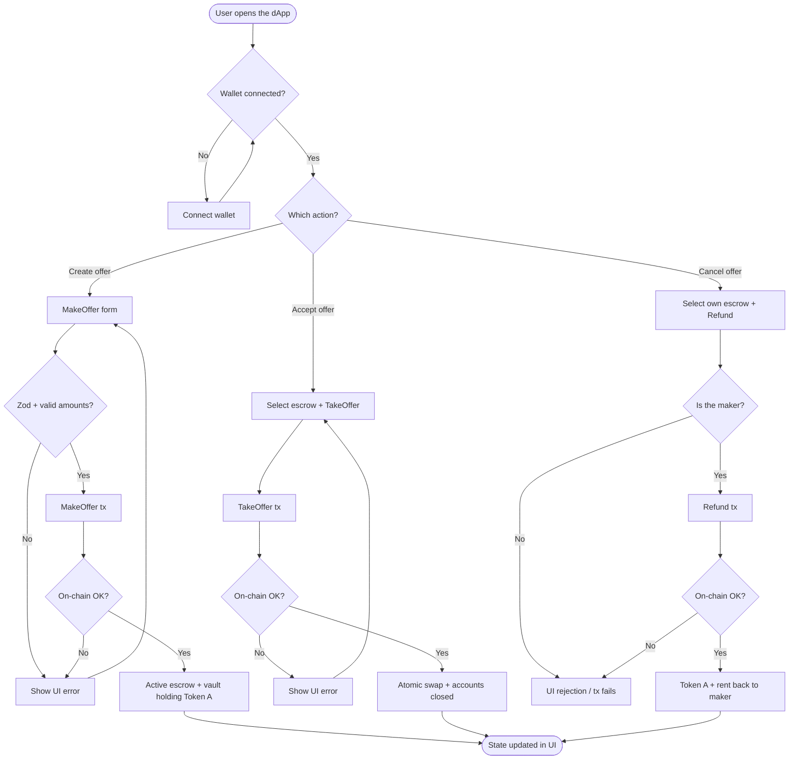
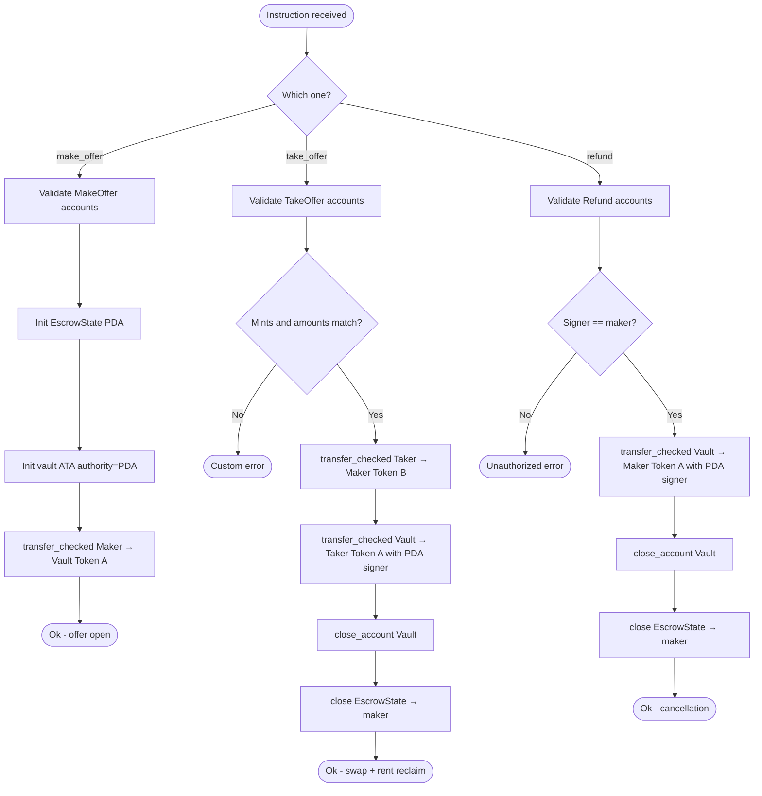
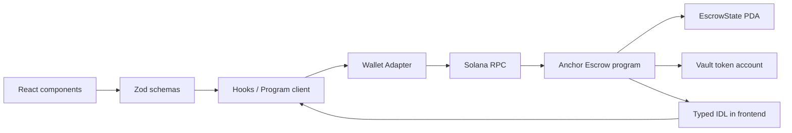

# System flow diagram

🇪🇸 [Versión en español](./02-diagrama-flujo-ES.md) · [Index](./README.md)

High-level view: decisions and paths of the escrow (on-chain + frontend).

## 1. General product flow

## 2. On-chain decision flow (program)

## 3. Frontend ↔ chain data flow

## Design notes

- Every transfer uses `transfer_checked` (explicit decimals).
- The vault authority is always the `EscrowState` PDA.
- TakeOffer and Refund close vault + state and return rent to the maker.
- The frontend does not assume accounts: it validates with Zod before building the transaction.
