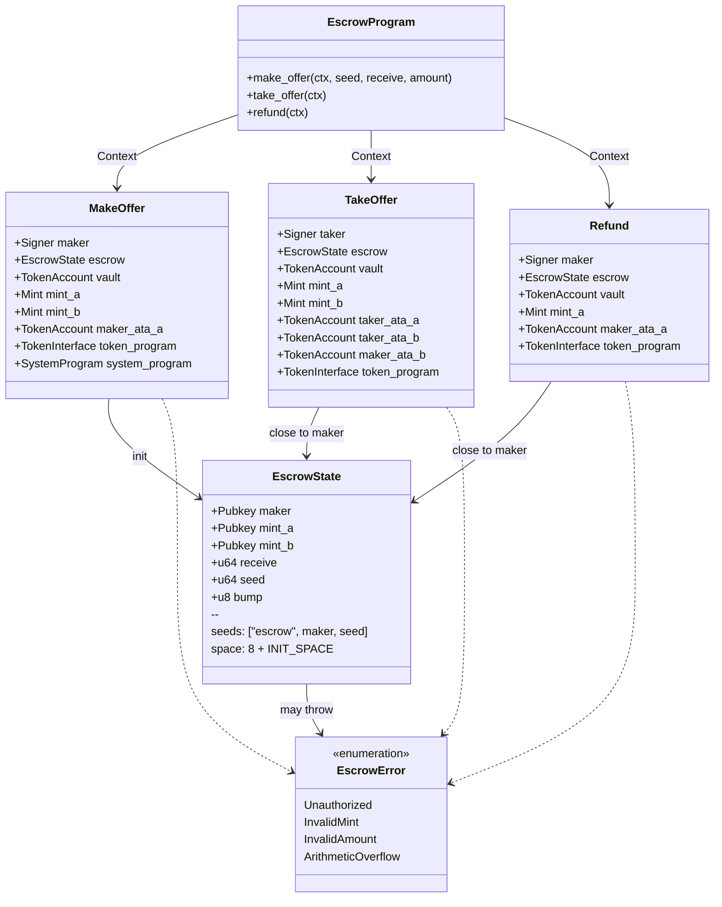
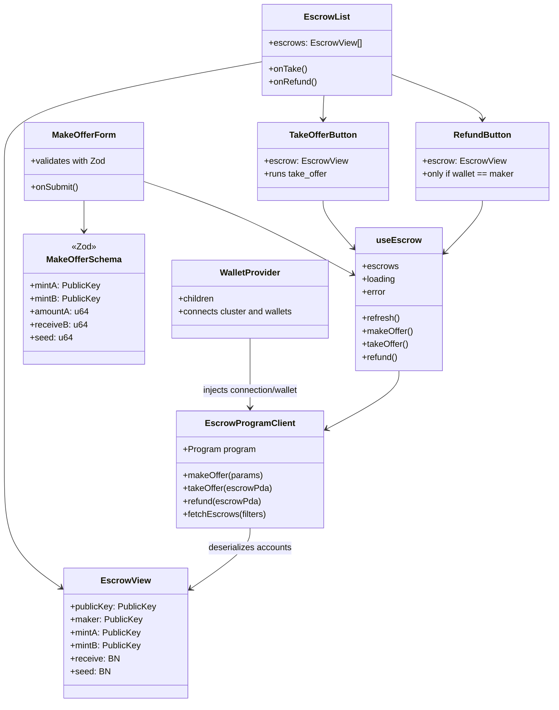
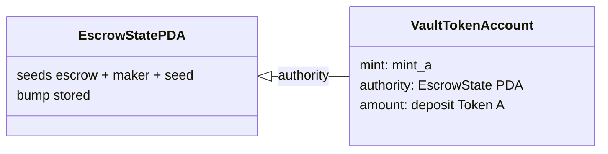

# Class diagram / structure

🇪🇸 [Versión en español](./03-diagrama-clases-ES.md) · [Index](./README.md)

On-chain account model, program modules and frontend layers. Solana has no classic OOP: the "classes" here represent accounts, contexts and TypeScript interfaces.

## 1. On-chain (Anchor program)

### `EscrowState` layout (ordered by size)

| Field | Type | Bytes |
|-------|------|-------|
| discriminator | — | 8 |
| maker | Pubkey | 32 |
| mint_a | Pubkey | 32 |
| mint_b | Pubkey | 32 |
| receive | u64 | 8 |
| seed | u64 | 8 |
| bump | u8 | 1 |
| **Approx. total** | | **~121** |

Goal: keep the state **under 128 bytes** to minimize rent.

---

## 2. Frontend (Next.js App Router)

---

## 3. Vault ↔ PDA relationship

The vault authority is **never** the maker or the taker: only the PDA can sign withdrawals via `signer_seeds`.
