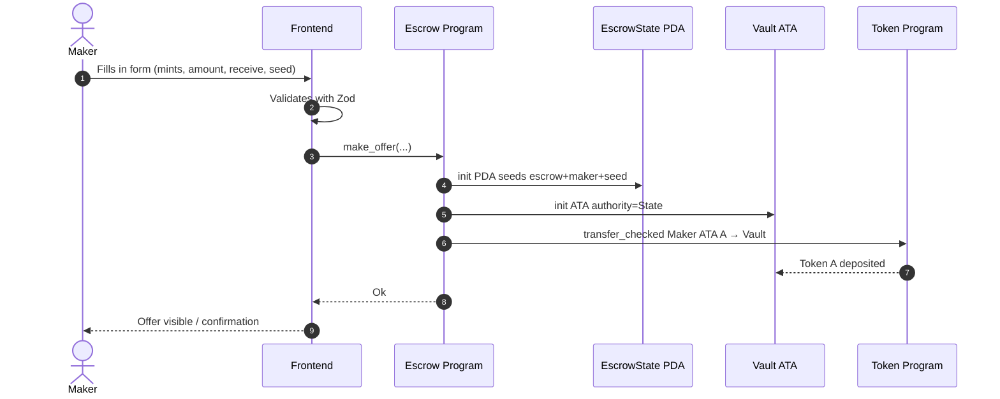
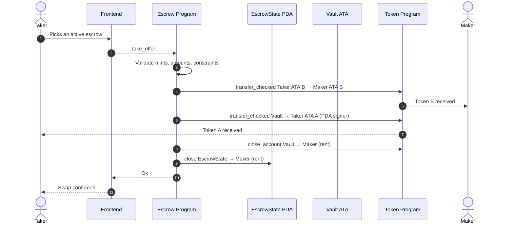
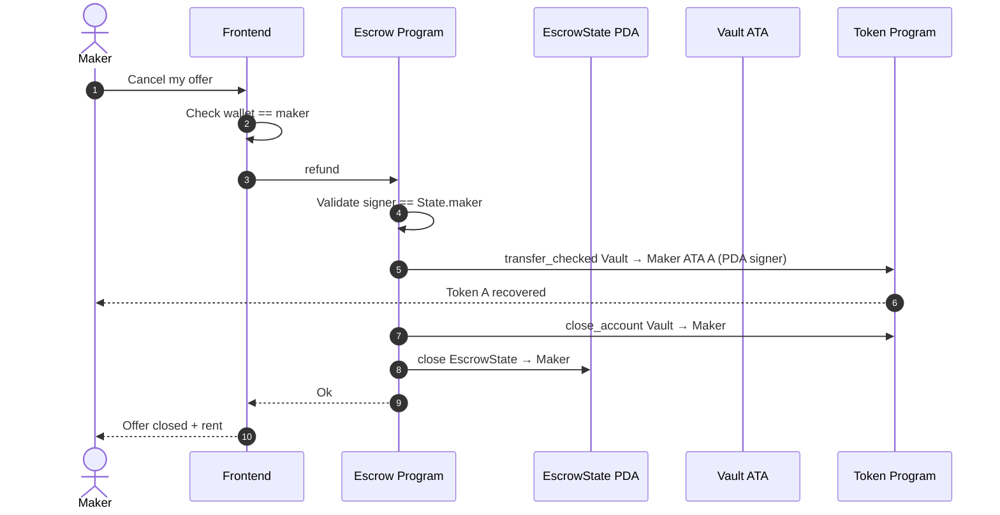
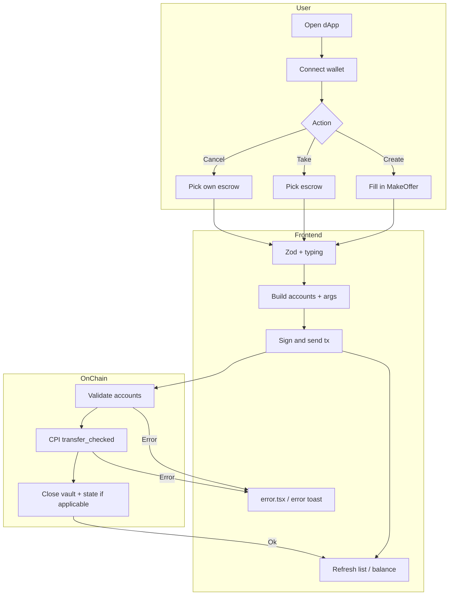
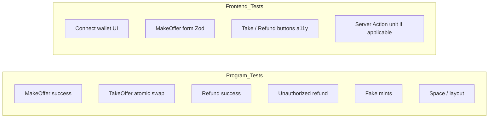

# Process flowchart

🇪🇸 [Versión en español](./04-flujograma-ES.md) · [Index](./README.md)

Time-ordered sequences (ordered steps) for each instruction and for the user in the dApp.

## 1. MakeOffer — on-chain sequence

## 2. TakeOffer — atomic swap

## 3. Refund — cancellation by the maker

## 4. dApp UX flowchart (swimlanes)

## 5. Account closing matrix

| Instruction | Token A | Token B | Vault | EscrowState | Rent |
|-------------|---------|---------|-------|-------------|------|
| MakeOffer | Maker → Vault | — | init | init | Maker pays |
| TakeOffer | Vault → Taker | Taker → Maker | close | close → maker | Maker recovers |
| Refund | Vault → Maker | — | close | close → maker | Maker recovers |

## 6. Mandatory test cases (aligned with the rules)

TDD order: write the test in the matching column **before** the Rust logic or the React component.
